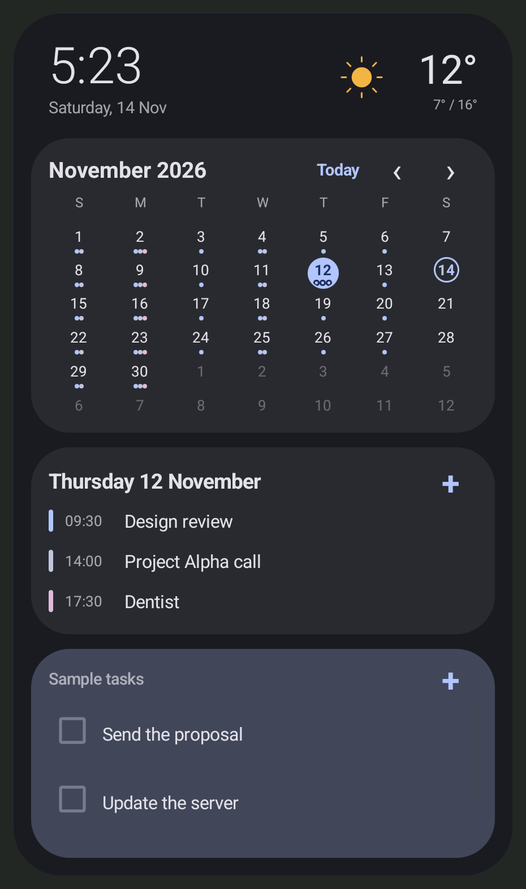

# Monthlane

Monthlane is an open-source Android home-screen widget combining a clock, weather, a monthly calendar, calendar events and tasks. It requires Android 12 (API 31) or newer. Each widget can show any combination of components; its selected date and components are independent of other widgets.



*Material appearance in dark mode, with demonstration data.*

## Setup

Add Monthlane from your launcher's widget picker and choose its components. Open the app to select calendars, appearance and weather location and to grant the relevant permissions. The widget displays a status when a required provider or permission is missing. Reconfiguration of an existing widget depends on launcher support.

Choose Material or Transparent appearance and system, light or dark mode. Weather has Standard and Compact styles: Standard includes daily minimum and maximum temperatures when available; Compact shows the current conditions and temperature. Legacy Condition selections use Standard.

Weather source credits and links are available in the app's weather settings. Attribution is preserved with cached weather readings and is not displayed on the widget.

Tap a calendar day to select it, an event to open it in a calendar app, or a task to open it in Tasks.org. A writable task's checkbox requests completion through Tasks.org; recurring tasks are handled by that provider. Read-only tasks cannot be completed in the widget. Android scheduling and provider availability can affect refresh and completion latency.

## Data sources and privacy

- Calendar events come from the Android Calendar Provider using `READ_CALENDAR`. By default, visible calendars are used; selecting no calendars explicitly shows none. Monthlane opens events in a calendar app and does not edit them directly.
- Tasks come from Tasks.org or a compatible provider through its local `v0` API, tested against Tasks.org 15.12. Separate read and write permissions are required. Up to 500 tasks are loaded per refresh. The provider's API is unstable and may change.
- Weather comes from Breezy Weather or a compatible provider, tested against Breezy Weather 6.2.2. Grant its provider permission and select a location. The widget reads the local provider; a refresh does not force a network request. The permission may expose coordinates of configured locations.

Monthlane does not request Internet or location permissions or require an account. It stores settings and last successful provider snapshots in private app storage; Android cloud backup and device-to-device transfer of app data are disabled. Provider data is not shown when the required permission is unavailable. Android power restrictions and the source apps' own refresh schedules can delay updates.

## Build and test

The project uses JDK 21, Android SDK API 36, Build Tools 36.0.0 and the pinned Gradle wrapper. In the configured development environment:

```sh
mise exec -- ./gradlew :app:assembleDebug :app:testDebugUnitTest :app:lintDebug :app:assembleDebugAndroidTest
```

Install the debug and instrumentation APKs on a dedicated emulator and run the instrumentation suite with `androidx.test.runner.AndroidJUnitRunner`. Provider integration tests require their corresponding apps and permissions. The scripts under `tools/` that change permissions or create test data are intended for a dedicated emulator, not a personal device. Generated builds and `outputs/` are excluded from version control.

Debug and performance test APKs use a debug certificate and are for testing only. A public release requires a separately secured release signing key and the checks in [the release checklist](docs/RELEASE.md). An APK signed with a different certificate cannot update an existing installation; uninstalling removes local settings and cached data.

## License

MIT. Dependencies retain their respective licenses. The [third-party software notices](app/src/main/assets/THIRD_PARTY_NOTICES.txt) are also included in the APK.
